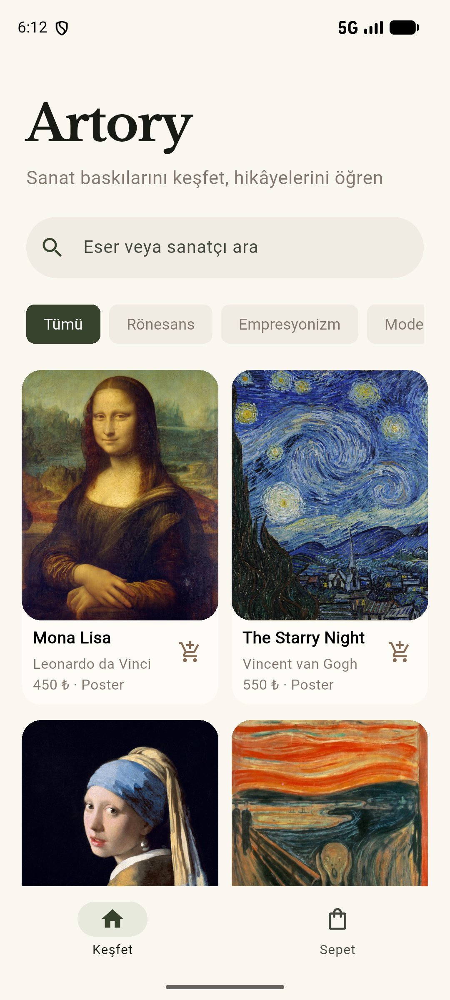
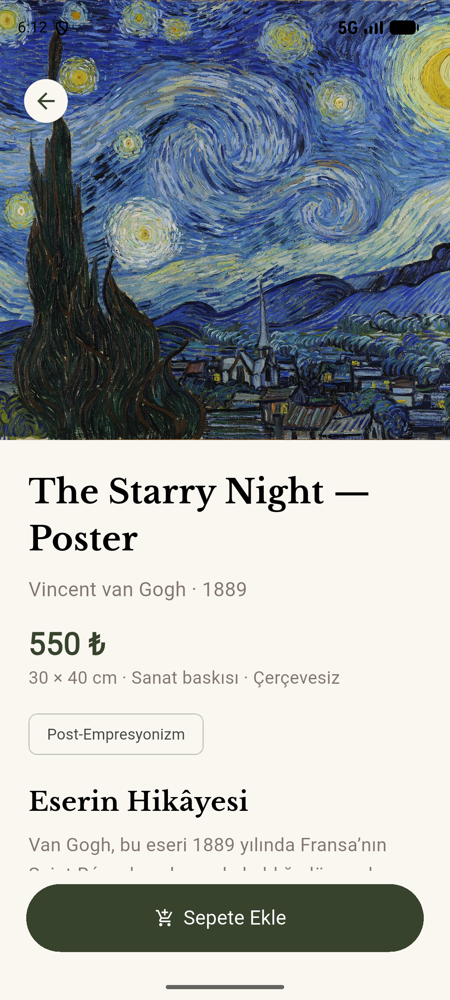
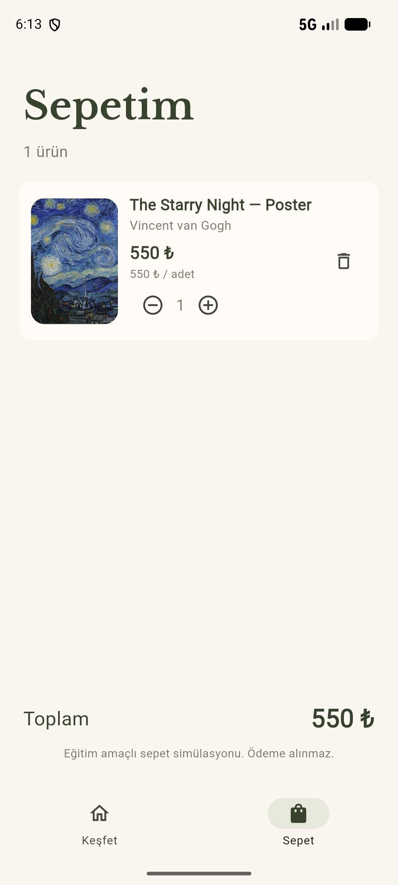

# Artory — Sanat Baskısı Kataloğu

Flutter ile geliştirilen eğitim amaçlı ürün kataloğu ve sepet simülasyonu. Eserlerin poster baskılarını keşfet, hikâyelerini öğren ve sepete ekle.

## Özellikler

- Eser/sanatçı araması ve dönem filtreleri; GridView ürün kartları.
- Fiyat, 30 × 40 cm çerçevesiz baskı bilgisi ve eser hikâyesi.
- Navigator.push/pop, MaterialPageRoute ve RouteSettings.arguments ile ürün detayına veri taşıma.
- ListView sepet: adet artırma/azaltma, ürün çıkarma, satır tutarı ve toplam tutar.
- Yerel JSON, fromJson/toJson modeli, Image.asset ve yerel fontlar.
- Ek üçüncü taraf Flutter paketi kullanılmaz.
- Sepet bellektedir; uygulama yeniden başlatılınca sıfırlanır. Fiyatlar demo verisidir; ödeme ve sipariş gönderimi yoktur.

## Çalıştırma

Kullanılan sürüm: Flutter 3.47.6 stable / Dart 3.13.5.

```sh
flutter pub get
flutter run
```

Android Studio Device Manager’dan emülatörü başlatın. iOS için macOS ve Xcode gerekir.

## Kontroller ve yapı

```sh
flutter analyze
```

`lib/models`: ürün modeli ve ortak sepet durumu. `lib/data`: yerel JSON okuma. `lib/screens`: ana ekran, katalog, detay ve sepet. `lib/widgets`: ortak görsel widget’ı. `lib/theme`: renkler ve uygulama teması.

Android sürümü Pixel 8 emülatöründe çalıştırılır. iOS derlemesi yapılmadı.

## Ekran görüntüleri

Pixel 8 Android emülatöründen alınan uygulama ekranları:

| Katalog | Ürün detayı | Sepet |
| --- | --- | --- |
|  |  |  |

## Kaynaklar ve teslim

Ürün kataloğu ve sepet akışı yerel JSON verisiyle simüle edilir.

Kamu malı eser reprodüksiyonları Wikimedia Commons’tan: [Mona Lisa](https://commons.wikimedia.org/wiki/File:Mona_Lisa,_by_Leonardo_da_Vinci,_from_C2RMF_retouched.jpg), [The Starry Night](https://commons.wikimedia.org/wiki/File:Van_Gogh_-_Starry_Night_-_Google_Art_Project.jpg), [Girl with a Pearl Earring](https://commons.wikimedia.org/wiki/File:Meisje_met_de_parel.jpg), [The Scream](https://commons.wikimedia.org/wiki/File:The_Scream.jpg).

Font lisansları `assets/fonts` içinde bulunur.

Katalogda 8 poster bulunur. Yeni görsel kaynakları: [The Great Wave](https://commons.wikimedia.org/wiki/File:Great_Wave_off_Kanagawa2.jpg), [The Kiss](https://commons.wikimedia.org/wiki/File:Klimt_-_The_Kiss.jpg), [The Birth of Venus](https://commons.wikimedia.org/wiki/File:The_Birth_of_Venus_(Botticelli)_1.jpg), [Water Lilies](https://commons.wikimedia.org/wiki/File:Monet%27s_Water_Lilies.jpg).
